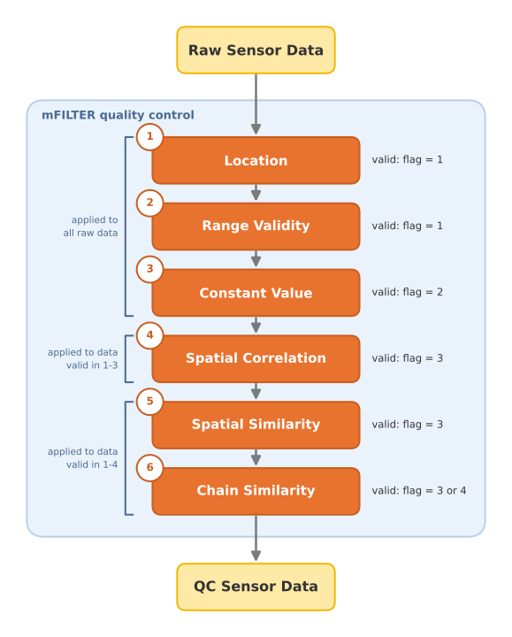

# mFILTER

**mFILTER** is an R package that adapts the [Framework for Improving Low-cost Technology Effectiveness and Reliability (FILTER)](https://www.sciencedirect.com/science/article/pii/S030147972501076X) to mobile sensors. It provides a set of algorithms to unify, quality-check, and flag outdoor, mobile, crowdsourced sensor observations.

mFILTER follows the processing pipeline of FILTER and was tested for the quality control (QC) of fine particulate matter observations (i.e., particles with a diameter smaller than 2.5 &mu;m, PM<sub>2.5</sub>) from mobile low-cost sensors. It offers statistical algorithms to harmonize, validate, and flag crowdsourced datasets, addressing the heterogeneity and variable reliability of measurements across different sensor networks.

The methodology of mFILTER is summarized in the figure below:

<p align="center">
  
</p>

The mFILTER methodology consists of six QC steps. Based on their outcomes, individual quality flags are assigned to indicate the reliability of each measurement. This hierarchical design allows users to tailor the QC process to the availability and characteristics of the data, and to the needs of each specific application.

## Table of Contents

- [Installation](#installation)
  - [From GitHub](#a-from-github)
  - [From a local file](#b-from-a-local-file)
  - [Loading the package](#loading-the-package)
- [Functionalities](#functionalities)
  - [Quality flags](#quality-flags)
- [Dependencies](#dependencies)
- [Data format](#data-format)
  - [Input](#input)
  - [Output](#output)

## Installation

### From GitHub

Install the development version of mFILTER from this repository using either the [`remotes`](https://remotes.r-lib.org) or the [`devtools`](https://devtools.r-lib.org) package:

```r
# install.packages("remotes")
remotes::install_github("CitiObs/ValAir-mFILTER")

# or, alternatively:
# install.packages("devtools")
devtools::install_github("CitiObs/ValAir-mFILTER")
```

### From a local file

Download mFILTER as a `.tar.gz` file and install it in your R environment:

```r
install.packages("path/to/mFILTER_x.y.z.tar.gz", repos = NULL, type = "source")
```

Replace `path/to/mFILTER_x.y.z.tar.gz` with the actual path and file name.

### Loading the package

Once the installation is complete, load the package with:

```r
library(mFILTER)
```

## Functionalities

The QC tests and their main helper functions are listed below.

| Test | Description | Function | Main helper functions |
|---|---|---|---|
| Location | Flags values that exceed realistic movement speed limits | `location_qctest()` | |
| Range Validity | Flags values outside physically realistic limits | `range_validity_qctest()` | |
| Constant Value | Flags persistent (constant) values | `constant_value_qctest()` | |
| Spatial Correlation | Flags values that are not correlated with those of neighboring sensors or reference stations | `spatial_correlation_qctest()` | `expected_correlation()` |
| Spatial Similarity | Flags values that are not similar to those of the closest reference stations | `spatial_similarity_qctest()` | `find_neighbors()` <br> `spatial_similarity()` |
| Chain Similarity | Flags values that are not similar to those of (a) the closest reference stations or (b) already validated sensors | `chain_similarity_qctest()` | `find_neighbors()` <br> `spatial_similarity()` |
  
### Quality flags
  
Each test adds a flag column to the dataset. The flag values that mark a valid measurement are shown in **bold**.

| Test | Flag column | Description |
|---|---|---|
| Location | `flag_location` | `0` invalid <br> **`1` valid** |
| Range Validity | `flag_range` | `0` out of range <br> **`1` within range** |
| Constant Value | `flag_constant_value` | `0` insufficient data <br> `1` constant <br> **`2` not constant** |
| Spatial Correlation | `flag_correlation` | `0` insufficient data <br> `1` isolated site <br> `2` not correlated with neighbors <br> **`3` correlated with neighbors ** |
| Spatial Similarity | `flag_similarity` | `0` insufficient data <br> `1` isolated site <br> `2` not similar <br> **`3` similar to the reference stations** |
| Chain Similarity | `flag_chain_similarity` | `0` insufficient data <br> `1` isolated site <br> `2` not similar <br> **`3` similar to validated sensors** <br> **`4` similar to the reference stations** |

The full QC procedure, with all six tests applied in sequence, can be run with a single call to `run_mFILTER_QC()`.

## Dependencies

All required R packages are installed automatically. See the `Imports` field in [DESCRIPTION](DESCRIPTION) for the full list.

## Data format

### Input

mFILTER supports datasets stored as a `data.frame` or a `tibble`. The functions do not require predefined column names: each column is assigned to its role through a function argument (for example, `id.column = "id"`). A dataset should contain the measurement location (e.g., ID or name, longitude and latitude) and the measurements (e.g., timestamp and value).

> [!IMPORTANT]
> Column names can be chosen freely, with one exception: when several datasets are combined (e.g., sensor and reference data), the time, longitude and latitude columns must have the same names in every dataset (e.g., `timestamp`, `longitude` and `latitude`).

An input dataset could have the following format:

| Column | Type | Description |
|---|---|---|
| `id` | integer or character | Identifier (ID) of the measurement location |
| `timestamp` | POSIXct | Timestamp of each measurement |
| `longitude` | numeric | Longitude of the measurement location |
| `latitude` | numeric | Latitude of the measurement location |
| `PM2.5` | numeric | Measurement values (e.g., PM<sub>2.5</sub>) |

### Output

mFILTER returns the input dataset with one additional column per QC test, containing the quality flags described in [Functionalities](#functionalities). For the input dataset above, the output has the following format:

| Column | Type | Description |
|---|---|---|
| `id` | integer or character | Identifier (ID) of the measurement location |
| `timestamp` | POSIXct | Timestamp of each measurement |
| `longitude` | numeric | Longitude of the measurement location |
| `latitude` | numeric | Latitude of the measurement location |
| `PM2.5` | numeric | Measurement values (e.g., PM<sub>2.5</sub>) |
| `flag_location` | numeric | Quality flag of the Location test |
| `flag_range` | numeric | Quality flag of the Range Validity test |
| `flag_constant_value` | numeric | Quality flag of the Constant Value test |
| `flag_correlation` | numeric | Quality flag of the Spatial Correlation test |
| `flag_similarity` | numeric | Quality flag of the Spatial Similarity test |
| `flag_chain_similarity` | numeric | Quality flag of the Chain Similarity test |
